# Exorcist

**Finds ghost funds in NEAR contracts, or proves there are none.**



Exorcist checks whether a NEAR contract can lose money when a cross-contract call fails. For a
vulnerable contract it prints a concrete, step-by-step attack trace and a Lean theorem, checked by the
Lean kernel, stating that the trace really breaks the invariant. For a fixed contract it gives an
exhaustive bounded search result and a Lean 4 proof that the invariant holds for **every** trace.
Every trace is also replayed against real Rust contracts in a local NEAR sandbox.
(Recording: `docs/media/demo.cast`, playable with `asciinema play`; regenerate with `scripts/record-demo.py`.)

## The opening case: the Oct 2026 NEAR Intents mechanism, found automatically

> `incident-2026-10` is **a minimal model of the mechanism, written from scratch — not their contract.**

The NEAR Intents postmortem describes it as follows: a deposit notifies a contract the depositor
chose; "the attacker created a contract that deliberately failed those notifications, causing the token
contract to refund the deposit while NEAR Intents retained the corresponding ledger credit"; 23 failed
deposits built $3.8M of unbacked balances, which were withdrawn (the funds were returned;
[summary of the postmortem](https://cryptonews.net/news/security/33604900/)). The model has a pool of
depositors (300 credited and held) and an attacker with 100 tokens. We give the explorer no hint about
the attack; it is asked only whether the attacker can ever cash out more than she put in:

```
$ ./.lake/build/bin/exorcist check incident-2026-10
RESULT: VIOLATION (insolvent) at depth 8, 26191 states explored in 45 ms. Shortest attack trace:

1. eve sends tx: token.ft_transfer_call(vault, 100, "notify hook") (+1 yocto)
     ledger: alice=300 eve=0 (total 300) | tokens: vault=300 alice=0 eve=100
2. run #0 token.ft_transfer_call(vault, 100, "notify hook")  ⇒ returns a promise
     ledger: alice=300 eve=0 (total 300) | tokens: vault=400 alice=0 eve=0
3. run #1 vault.ft_on_transfer(eve, 100, "notify hook")  ⇒ returns a promise
     ledger: alice=300 eve=100 (total 400) | tokens: vault=400 alice=0 eve=0
4. FAIL #3 hook.on_deposit(eve, 100)  ⇒ adversary makes it fail
     ledger: alice=300 eve=100 (total 400) | tokens: vault=400 alice=0 eve=0
5. run #2 token.ft_resolve_transfer(eve, vault, 100)  ⇒ ok, returns 0  — refunds 100 vault → eve
     ledger: alice=300 eve=100 (total 400) | tokens: vault=300 alice=0 eve=100   ⚠ INSOLVENT (ledger > tokens held)
6. eve sends tx: vault.withdraw(100)
     ledger: alice=300 eve=100 (total 400) | tokens: vault=300 alice=0 eve=100   ⚠ INSOLVENT (ledger > tokens held)
7. run #5 vault.withdraw(100)  ⇒ ok (no value)
     ledger: alice=300 eve=0 (total 300) | tokens: vault=300 alice=0 eve=100
8. run #6 token.ft_transfer(eve, 100)  ⇒ ok (no value)
     ledger: alice=300 eve=0 (total 300) | tokens: vault=200 alice=0 eve=200   ⚠ INSOLVENT (ledger > tokens held)

Witness theorem: out/incident-2026-10.witness.lean
  ✓ checked by the Lean kernel (decide): this trace really violates the property
```

Timings vary by machine. The fixed contract credits only after the notification has succeeded. It is
clean up to depth 10 (1,289,374 states) and proven solvent for every trace:

```
$ ./.lake/build/bin/exorcist prove incident-2026-10-fixed
RESULT:    ✓ PROVEN FOR ALL TRACES: solvent (checked by the Lean kernel now, file out/prove-incident-2026-10-fixed.lean)
axioms:    'incident_2026_10_fixed_solvent_all_traces' depends on axioms: [propext, Classical.choice, Quot.sound]
axioms:    'NearAsync.Vault.Proof.fixed_vault_solvent_forever' depends on axioms: [propext, Classical.choice, Quot.sound]
```

`Verifier/Witness/Incident.lean` also checks, with the kernel, the repeated version: two failed deposits
and one withdrawal leave the attacker with 300 tokens and the pool backed by only 100. The same
transactions against the fixed contract leave everything whole.

## The problem

NEAR cross-contract calls are asynchronous. Every receipt commits on its own; when a later receipt
fails, earlier state changes are **not** rolled back. With NEP-141 tokens this has a sharp edge:
`ft_transfer_call` moves the tokens, calls the receiver's `ft_on_transfer`, and then
`ft_resolve_transfer` **refunds the sender** if that call — or the promise it returned — failed, or
did not return a number.

So a receiver that credits its internal ledger and then hands the token a promise that can fail
(for example a notification to a contract the depositor controls) can be made to credit a deposit
that is refunded. Repeat, then withdraw: the "ghost" balance is paid out from other users' tokens.
Tests usually cover the happy path, not every combination of orderings and failures.

This is the mechanism NEAR Intents' postmortem describes for the exploit of Sept 29 – Oct 1, 2026:
"The attacker created a contract that deliberately failed those notifications, causing the token
contract to refund the deposit while NEAR Intents retained the corresponding ledger credit", building
$3.8M of unbacked balances over 23 failed deposits; the funds were returned. The postmortem also notes
that monitoring "did not compare users' aggregate internal balances with the tokens actually held" —
the invariant Exorcist checks. ([cryptonews summary of the Oct 16 postmortem](https://cryptonews.net/news/security/33604900/))

## What Exorcist does

1. **A model of NEAR async execution in Lean 4** (`Verifier/Async.lean`): receipts, promises,
   `.then` callbacks with `PromiseResult` (success/failure), per-receipt commit with no cross-receipt
   rollback, promise return, deposit refunds to the predecessor, any order of ready receipts.
   Each rule is sourced in [docs/SEMANTICS.md](docs/SEMANTICS.md).
2. **NEP-141 token model** (`Verifier/Token.lean`) following the near-sdk-rs 5.30.1 reference
   implementation, including `ft_resolve_transfer`'s `min(unused, receiver balance)` refund.
3. **Contract models** as `state → call → (new state, emitted calls, return)`
   (`Verifier/Models/Vault.lean`): a deposit-ledger vault with two bug patterns and their fixes.
4. **Bounded explorer** (`exorcist check`): every interleaving and every receipt failure up to depth N.
   It prints the shortest attack trace, a JSON file with the expected balances after every step, and a
   generated witness `.lean` file that the Lean kernel checks immediately.
5. **Unbounded proofs** (`exorcist prove`): inductive invariants proving that the fixed vault is solvent
   after every trace, with any accounts, any amounts, arbitrary attacker contracts and **any** receipt
   failures, and that it never strands a user's tokens (no stuck funds) (`Verifier/Proof/`).
6. **Sandbox validation**: Rust versions of the token, vault variants and hook, and near-workspaces tests that
   replay every trace and compare the chain state to the model after every transaction.
7. **CI**: a GitHub Action that fails a pull request when a deployed contract's model has a violation.
8. **Agent gate** (`mcp/exorcist_mcp.py`): an MCP server through which an AI coding agent must get
   `deploy_allowed: true` from `exorcist_check` / `exorcist_prove` before shipping
   ([docs/AGENT-GATE.md](docs/AGENT-GATE.md)).
9. **Your own contract in about 20 lines**: `exorcist new <name>` scaffolds a model; `check` and
   `prove --bounded N` (kernel-checked) work on it ([docs/WRITE-A-MODEL.md](docs/WRITE-A-MODEL.md)).
10. **EXPERIMENTAL `exorcist draft --from lib.rs`**: NEAR AI drafts a model from Rust, and a human reviews
    it ([docs/DRAFT.md](docs/DRAFT.md)). On our three contracts, every draft compiled in the first round
    and matched the hand-written models on all 8 checks ([drafts/ASSESSMENT.md](drafts/ASSESSMENT.md)).

## Quickstart

Prerequisites: `git`, `curl`, `python3` and [elan](https://github.com/leanprover/elan), the Lean toolchain
manager, which installs the pinned Lean 4.34.0 automatically. Only `make demo` and `make sandbox` also need
[rustup](https://rustup.rs), which installs the pinned Rust 1.96.0 and the wasm target automatically.
Below, `exorcist` means `./.lake/build/bin/exorcist` (built by `make quick`).

```sh
curl https://raw.githubusercontent.com/leanprover/elan/master/elan-init.sh -sSf | sh -s -- -y --default-toolchain none
git clone https://github.com/jatinsahijwani/exorcist && cd exorcist
```

**1. Fast screening, no sandbox** (about 1.5 minutes on a fresh clone with Lean installed, under a minute
afterwards; the very first run also downloads the Lean toolchain, a few minutes):

```sh
make quick
```

You should see this table at the end:

```
PASS    lake build: semantics, models, witness + liveness theorems, unbounded proof  kernel-checked
PASS    incident-2026-10: attack found, witness theorem kernel-checked            found at depth 8 (26191 states)
PASS    deposit-vulnerable: attack found, witness theorem kernel-checked          found at depth 5 (444 states)
PASS    noreturn-vulnerable: attack found, witness theorem kernel-checked         found at depth 5 (438 states)
PASS    withdraw-vulnerable: attack found, witness theorem kernel-checked         found at depth 5 (3622 states)
PASS    incident-2026-10-fixed: no violation, honest deposit + withdraw reachable  bounded to depth 10
PASS    deposit-fixed: no violation, honest deposit + withdraw reachable          bounded to depth 10
PASS    noreturn-fixed: no violation, honest deposit + withdraw reachable         bounded to depth 10
PASS    withdraw-fixed: no violation, honest deposit + withdraw reachable         bounded to depth 10
PASS    incident-2026-10-fixed: solvent (sum of ledger <= tokens held)            proven for all traces
PASS    deposit-fixed: solvent (sum of ledger <= tokens held)                     proven for all traces
PASS    noreturn-fixed: solvent (sum of ledger <= tokens held)                    proven for all traces
PASS    withdraw-fixed: solvent (sum of ledger <= tokens held)                    proven for all traces
PASS    withdraw-fixed: no stuck funds (tokens held = ledger when idle)           proven for all traces
PASS    noreturn-fixed: no stuck funds (tokens held = ledger when idle)           proven for all traces
PASS    agent gate (MCP): vulnerable blocked, fixed allowed                       check + prove via MCP
PASS    sandbox replay skipped (QUICK=1)                                          -

ALL PASS
```

**2. See an attack in detail** (the opening case above is `exorcist check incident-2026-10`):

```sh
./.lake/build/bin/exorcist check deposit-vulnerable
```

```
RESULT: VIOLATION (insolvent) at depth 5, 444 states explored in 1 ms. Shortest attack trace:

1. eve sends tx: token.ft_transfer_call(vault, 100, "notify hook") (+1 yocto)
     ledger: alice=100 eve=0 (total 100) | tokens: vault=100 alice=0 eve=100
2. run #0 token.ft_transfer_call(vault, 100, "notify hook")  ⇒ returns a promise
     ledger: alice=100 eve=0 (total 100) | tokens: vault=200 alice=0 eve=0
3. run #1 vault.ft_on_transfer(eve, 100, "notify hook")  ⇒ returns a promise
     ledger: alice=100 eve=100 (total 200) | tokens: vault=200 alice=0 eve=0
4. FAIL #3 hook.on_deposit(eve, 100)  ⇒ adversary makes it fail
     ledger: alice=100 eve=100 (total 200) | tokens: vault=200 alice=0 eve=0
5. run #2 token.ft_resolve_transfer(eve, vault, 100)  ⇒ ok, returns 0  — refunds 100 vault → eve
     ledger: alice=100 eve=100 (total 200) | tokens: vault=100 alice=0 eve=100   ⚠ INSOLVENT (ledger > tokens held)

Witness theorem: out/deposit-vulnerable.witness.lean
  ✓ checked by the Lean kernel (decide): this trace really violates the property
```

The exit code is 1 (the millisecond figure varies by machine). The search is compiled Lean code, so hundreds of thousands of states per second is
normal. Before the result it prints the exact bounds (depth, actors, amounts,
transactions, which receipts the adversary may fail); after it, the same transactions replayed on the
fixed vault, and the liveness checks. Add `--json FILE` for machine-readable output with the expected
balances and ledger after every step.

**3. See the proof of the fix:**

```sh
./.lake/build/bin/exorcist prove deposit-fixed
```

```
RESULT:    ✓ PROVEN FOR ALL TRACES: solvent (checked by the Lean kernel now, file out/prove-deposit-fixed.lean)
axioms:    'deposit_fixed_solvent_all_traces' depends on axioms: [propext, Classical.choice, Quot.sound]
axioms:    'NearAsync.Vault.Proof.fixed_vault_solvent_forever' depends on axioms: [propext, Classical.choice, Quot.sound]
```

**4. Everything, including the real-contract sandbox replay** (the first run downloads Rust and compiles
the Rust dependencies, about 5–10 minutes; later runs about 3–5 minutes):

```sh
make demo
```

This adds one row per sandbox test (8 trace replays, e.g. `PASS  sandbox: deposit_attack_on_vulnerable_vault
matches model step by step`, plus a negative-control test showing the harness rejects a wrong prediction),
and ends with `ALL PASS`.

Other commands: `exorcist list` (all models), `exorcist new <name>`, `make check` (CI gate), `make prove`,
`make sandbox`, `make test-mcp` (agent gate), `make test-walkthrough`, `make test-draft`.
How the pieces fit: [docs/ARCHITECTURE.md](docs/ARCHITECTURE.md).

## Results

| Model | Result | Label |
|---|---|---|
| `incident-2026-10` (minimal model of the Oct 2026 mechanism, not their contract) | attacker cashes out 200 from a 100 deposit; found automatically in 26,191 states | found at depth 8, witness kernel-checked |
| `incident-2026-10-fixed` | no violation (1,289,374 states); solvent | bounded to depth 10; **proven for all traces** |
| `deposit-vulnerable` | insolvent after 5 steps; eve can then withdraw alice's tokens | found within depth 10, witness kernel-checked |
| `deposit-fixed` | no violation (1,044,233 states) | bounded to depth 10 |
| `deposit-fixed` | solvent | **proven for all traces** |
| `noreturn-vulnerable` | insolvent after 5 steps **without any failure** (hook returns nothing) | found within depth 10, witness kernel-checked |
| `noreturn-fixed` | no violation (839,929 states); solvent | bounded to depth 10; **proven for all traces** |
| `withdraw-vulnerable` | user's tokens stuck in the vault after a failed payout | found within depth 10, witness kernel-checked |
| `withdraw-fixed` | no violation (11,154,645 states); solvent | bounded to depth 10; **proven for all traces** |
| `withdraw-fixed`, `noreturn-fixed` | no stuck funds: when nothing is in flight, tokens held = Σ ledger | **proven for all traces** (assumptions below) |
| sandbox | all 8 trace replays match the model after every transaction; negative control passes | real Rust contracts, near-workspaces |
| **NEAR testnet** | the attack drains the vulnerable vault; the same transactions leave the fixed vault whole ([links](#testnet-replay)) | live chain, matches the model |
| agent gate (MCP) | an AI agent is blocked from deploying `withdraw-vulnerable` and allowed after the fix | tested in CI and `make demo` |
| `exorcist draft` (experimental) | NEAR AI drafts of all 3 contracts: compile in round 1, 8/8 checks match, faithful on review | evidence on 3 contracts |
| your model (`exorcist new`) | walkthrough: the scaffold is clean; a "debit on success" variant pays alice twice | tested end to end in CI |

Details, bounds and `#print axioms` output: [docs/RESULTS.md](docs/RESULTS.md).
A pull request that reintroduces the bug, and the failing check: [docs/EXAMPLE_PR.md](docs/EXAMPLE_PR.md).

## How NEAR fits

* **Async receipts.** The model is NEAR's execution model: independent receipts, `.then` callbacks
  that always run, `PromiseResult::Failed`, promise return, no cross-receipt rollback, deposit refunds
  to the predecessor.
* **NEP-141.** The token model and the Rust token follow the near-sdk-rs reference
  `ft_transfer_call` / `ft_on_transfer` / `ft_resolve_transfer` flow, which is where the refund that
  creates ghost funds comes from.
* **near-workspaces sandbox and testnet.** Model predictions are checked against real contracts in the
  NEAR sandbox; `scripts/testnet-replay.sh` runs the same attack on NEAR testnet.
* **NEAR AI Cloud.** `exorcist prove <model> --ai` runs a proof-repair loop, and the experimental
  `exorcist draft` drafts models from Rust, both on NEAR AI Cloud's OpenAI-compatible API
  (`https://cloud-api.near.ai/v1`, key from `NEARAI_API_KEY`). Everything else works without a key.
* **Agents that ship contracts.** The MCP agent gate lets an AI agent deploy only what Exorcist accepts.

## What exactly is proven

`NearAsync.Vault.Proof.fixed_vault_solvent_forever`: for any account type, token `T` and vault
`V ≠ T`, any code on all other accounts (it may emit any calls but cannot write the token's or the
vault's storage), any set of receipts the adversary may fail, any transactions with any arguments and
amounts from accounts other than `T` and `V`, and any initial state with nothing in flight and a backed
ledger: after every finite trace, `Σ ledger ≤ tokens held by V`. `concrete_fixed_solvent` is the same
theorem instantiated for the explorer's five-actor models (what `exorcist prove` checks). It holds for both withdraw variants
and any hook (it assumes only that deposits are credited in the callback).

`NearAsync.Vault.Proof.fixed_vault_no_stuck_funds` (the withdraw pattern's property): with both fixes,
if the adversary fails only non-callback receipts (callbacks have gas reserved) and nobody sends the
vault tokens with a plain `ft_transfer` (a donation is owed to no one), then from an initial state where
the ledger equals the vault's balance: after every trace, tokens held ≤ Σ ledger + in-flight amounts,
and whenever nothing is in flight, tokens held = Σ ledger. Other contracts are still arbitrary code.
`concrete_no_stuck` instantiates it for `withdraw-fixed` and `noreturn-fixed`.

The solvency invariant (`Verifier/Proof/Defs.lean`): Σ ledger + every refund that a pending
`ft_resolve_transfer` may still make + every amount a pending `after_withdraw` may still restore
≤ tokens held. It also requires well-formed pending receipts: fresh, distinct ids, and every in-flight
credit or vault transfer has its callback waiting on it for at least that amount.

## Limits

* **The models are written by hand** (with AI assistance) from the Rust contracts and reviewed by a
  human. Exorcist does not yet read Rust; automatic extraction is on the roadmap. If the Rust differs
  from the model, the proof says nothing about the Rust. The sandbox replay is how we check that they
  agree on the traces we run.
* **Proofs are only as good as the specification and the semantics model.** The invariant is solvency
  of the vault's ledger. The semantics follows NEAR docs and the near-sdk-rs reference (sources in
  docs/SEMANTICS.md).
* **Not modelled:** gas (instead the adversary may fail receipts; the proof allows any receipt to
  fail), storage staking and NEP-145 registration (every account is treated as registered), deleted
  accounts (the reference token burns refunds to deleted senders), u128 overflow (amounts are unbounded
  naturals), `promise_set_refund_to`, joint promises (`and`).
* **Bounded results are bounded.** "No violation up to depth 10" covers the listed actors, amounts and
  transactions only. Only rows labelled "proven for all traces" are unbounded.
* The no-stuck-funds theorem assumes callbacks are not failed (enough gas reserved) and no plain
  `ft_transfer` donations to the vault; the solvency theorem has neither assumption.
* The example contracts are small and written for this project; they are not production contracts.
* `incident-2026-10` models the mechanism described in a public postmortem. It is not the NEAR Intents
  contract and says nothing about that contract's current code.
* `prove --bounded N` is kernel-checked but bounded; keep N small (4–5), because kernel evaluation is slow.
* `exorcist draft` is experimental. Its drafts of our three small contracts matched the hand-written
  models, but that is evidence on three contracts, not a general claim; every draft still needs human review.
* The hand-written vault model does not include near-sdk's rule that non-payable methods reject an
  attached deposit; the NEAR AI drafts do. No scenario here attaches such a deposit, so no verdict changes.

## Trusted base

* The Lean 4 kernel (v4.34.0) and Lean's standard axioms (`propext`, `Classical.choice`, `Quot.sound`).
  No `sorry`, no `native_decide` (witnesses use `decide`), so the compiler is not trusted for any theorem.
* The faithfulness of `Verifier/Async.lean` and `Verifier/Token.lean` to NEAR and NEP-141, and of
  the vault model to the Rust vault. The sandbox replay checks this on the replayed traces, not in general.
* The statement of the invariant (read `Verifier/Proof/Defs.lean` and `Theorem.lean`).
* Not trusted: the explorer (its traces are re-checked by the kernel) and the AI loop (its proposals
  are checked by Lean, and rejected if they change the statement or use `sorry`/`native_decide`/axioms).

## Repository layout

| Path | What |
|---|---|
| `Verifier/Async.lean` | NEAR async semantics |
| `Verifier/Token.lean` | NEP-141 token model |
| `Verifier/Models/` | vault variants, hook, registry of models and liveness goals |
| `Verifier/Explore.lean` | bounded explorer |
| `Verifier/Witness/` | kernel-checked witness and liveness theorems |
| `Verifier/Proof/` | unbounded solvency proof |
| `Main.lean`, `Exorcist/Prove.lean` | `exorcist` CLI (`check`, `prove`, `--ai`) |
| `sandbox/` | Rust contracts, replay library, near-workspaces tests, testnet binary |
| `mcp/` | MCP agent-gate server and the scripted agent test |
| `Verifier/Models/User.lean` | registry of your models (`exorcist new` creates them under `Verifier/Models/User/`) |
| `scripts/` | `demo.sh`, `testnet-replay.sh`, `test-walkthrough.sh`, `drafts.sh`, `record-demo.py` |
| `docs/site/` | static results page (for GitHub Pages; deploy with the manual `pages` workflow once public) |
| `action.yml`, `.github/workflows/` | reusable GitHub Action and this repo's CI |
| `docs/` | semantics, results, architecture, example PR |

## Testnet replay

**Done on 2026-11-11.** The attack and the fixed vault were replayed on NEAR testnet, and the chain state
matched the model after every transaction:

| | Vulnerable vault | Fixed vault |
|---|---|---|
| deposit with a failing hook | [tx](https://testnet.nearblocks.io/txns/EBigWS13rHHqTDYNKMsamY9d4bhcdpuR4v1GFUkMxycN): refunded **and** credited | [tx](https://testnet.nearblocks.io/txns/G9f5oowAE1Y1tmjBR1ePsAxmPtdSdtZ6aYcYkuPKppqG): refunded, not credited |
| eve withdraws 100 | [tx](https://testnet.nearblocks.io/txns/qSjvAX1otfxW8iBi2SJ9ebh5cMcYqhry2ftW5Wo3czm): pays out; vault ends at 0 | [tx](https://testnet.nearblocks.io/txns/FNioJzWavui9B3AN4jqMkuL5FUUQeTz2RYzaPjDDCDzV): panics; vault keeps 100 |

Contracts: [vulnerable vault](https://testnet.nearblocks.io/address/vault-x404319v.exorcist-replay-35b9fa.testnet),
[fixed vault](https://testnet.nearblocks.io/address/vault-x404319f2.exorcist-replay-35b9fa.testnet),
[token](https://testnet.nearblocks.io/address/token-x404319.exorcist-replay-35b9fa.testnet),
[hook](https://testnet.nearblocks.io/address/hook-x404319.exorcist-replay-35b9fa.testnet). Details: [docs/RESULTS.md](docs/RESULTS.md).

Run it yourself (testnet only; needs about 10 testnet NEAR, e.g. a faucet-sponsored account):

```sh
near account create-account sponsor-by-faucet-service you-exorcist.testnet autogenerate-new-keypair \
  save-to-legacy-keychain network-config testnet create     # key goes to ~/.near-credentials
EXORCIST_TESTNET_ACCOUNT=you-exorcist.testnet scripts/testnet-replay.sh
```

It deploys the token, hook, vulnerable and fixed vaults under that account, replays the attack against
both, checks the chain state against the model after every transaction, and prints `testnet.nearblocks.io`
links. It reads the key from `~/.near-credentials/testnet/<account>.json`, or from
`EXORCIST_TESTNET_PRIVATE_KEY`, and refuses to run if the account or RPC is not testnet.

## Using it in another repository

```yaml
- uses: jatinsahijwani/exorcist@main
  with:
    models: deposit-fixed withdraw-fixed
    depth: "10"
    prove: "true"
```

Models are compiled into the tool: to check your own contract, add a model under `Verifier/Models/`,
register it in `Registry.lean`, and point the action's `path` input at your fork.

## Libraries and tools

Lean 4 v4.34.0 (core only, no Mathlib) · Rust 1.96.0 · near-sdk 5.30.1 · near-workspaces 0.24.0 ·
tokio, serde, serde_json, anyhow · NEAR AI Cloud API (optional) · elan, lake, cargo.
The code was written during the hackathon with AI coding assistance (Claude Code) and reviewed by the author.

## Hackathon window

All code in this repository was written during NEAR HACKATHON, starting 2026-11-11 (Q-001). There is
no pre-hackathon baseline. Libraries and AI assistance are listed above (Q-005).

## Tracks

`security` (AI Security & Defense) and `open` (Open Innovation).

## Roadmap

* Extract models from Rust contracts automatically (near-sdk method bodies to the contract DSL).
* Model callback gas reservations, so the no-stuck-funds theorem no longer needs to assume callbacks succeed.
* More patterns: NEP-171/245 transfers with callbacks, multi-token vaults, `promise_and` joins.
* Use the AI repair loop for the invariant proof of new contracts, not only the model-level corollaries.
* Grow `exorcist draft` from experiment to a reviewed workflow, starting with real NEAR AI drafts of the three contracts here.

## Background facts

* NEAR Intents exploit: see "The problem" above and the
  [postmortem summary](https://cryptonews.net/news/security/33604900/).
* NEAR AI's Lean agent solved all 672 PutnamBench problems (670 upstream plus corrected versions of two
  flawed ones) for about $112 of model cost ([nearai/putnambench-deepseek](https://github.com/nearai/putnambench-deepseek)).
* NEAR has announced that it is next applying AI-assisted formal verification to "the NEAR protocol and
  core smart contracts" ([crypto.news](https://crypto.news/near-ai-formal-verification-protocol-smart-contracts/)).

## License

MIT, see [LICENSE](LICENSE).
