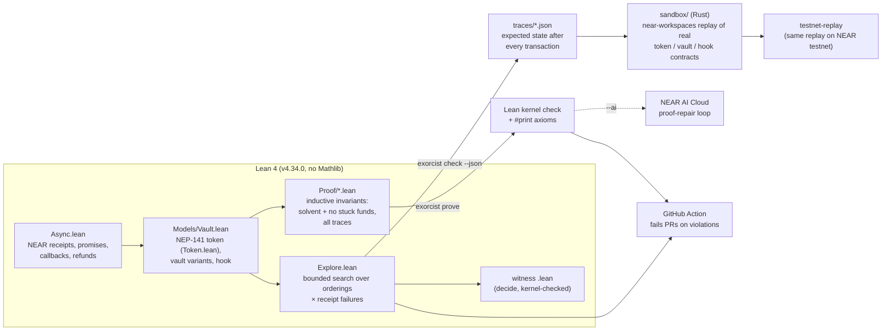

# Architecture

* **Semantics** (`Verifier/Async.lean`) is generic in accounts, calls and contract state. A step is:
  submit a transaction, run a ready receipt, or (adversary) fail a ready receipt. A failed receipt
  discards only its own changes; dependents receive `failed`; deposits are refunded to the predecessor.
* **Contracts** are functions `Ctx → Call → State → (State × emitted promises × return)`:
  `Token.lean` (NEP-141, following the near-sdk-rs reference), `Models/Vault.lean` (vault with bug
  switches, hook), `Models/Registry.lean` (the named models and liveness goals).
* **Explorer** (`Explore.lean`): iterative deepening, so the first violation is a shortest one. Its
  output is untrusted; each trace is re-run by the kernel in a generated witness theorem.
* **Proof** (`Proof/`): `Defs` (invariant), `Lemmas`/`Generic`/`Ok` (structure: failures, refunds,
  fresh receipts, promise redirection), `Solvency` (one case per contract method), `Theorem`
  (step → trace → headline theorem, and the concrete instance). `NoStuckDefs`/`NoStuck`/`NoStuckCases`:
  the exact-accounting invariant behind `fixed_vault_no_stuck_funds`.
* **CLI** (`Main.lean`, `Exorcist/Prove.lean`): `exorcist list | check | prove`.
* **Sandbox** (`sandbox/`): Rust contracts written for this project, a replay library, tests, and the
  testnet binary.
